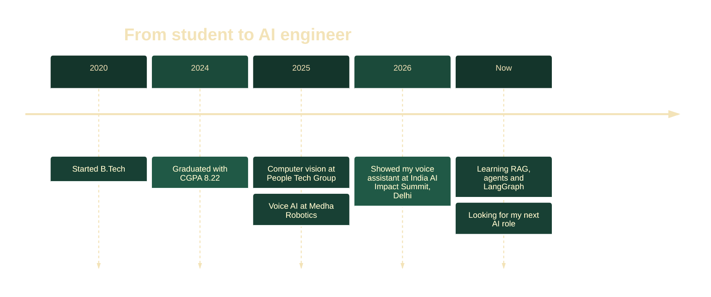

[LinkedIn](https://linkedin.com/in/harikishore-anem-27b62424a) · [Email](mailto:harikishoreanem@gmail.com) · [Resume](Harikishore_Anem_Resume.pdf) · Portfolio: coming soon · Hyderabad, open to relocation

I’m a developer who builds AI systems that work in real time. At People Tech Group I trained and tuned YOLO models that detect objects on live video, and at Medha Robotics I built a multilingual voice assistant that was showcased at the India AI Impact Summit 2026 in Delhi. I enjoy the hands-on side of AI: collecting and cleaning data, training models, and getting them to run on real cameras and microphones. I’m looking for AI Engineer and Machine Learning Engineer roles and I’m open to relocating.

Wake-word detection, speech to text, an LLM (TinyLLaMA) and Sarvam AI for multilingual replies, then text to speech. I built the full end-to-end pipeline and showed it at the India AI Impact Summit 2026. *Repo coming soon.*

YOLO models that spot helmets and distracted drivers, running on live ESP32-CAM video through OpenCV. I collected and annotated the data, trained the models, and tuned the pipeline for real-time use. *Repo coming soon.*

| I make machines see | I make machines listen | I make it all run |
|---|---|---|
| YOLO · OpenCV · object detection · image classification · real-time inference | STT · TTS · LLM APIs · multilingual voice · RAG, agents, LangGraph (learning) | Python · PyTorch · TensorFlow · SQL · Pandas · Git · REST APIs · AWS (basic) |

<b>Quick facts for recruiters</b>

| | |
|---|---|
| **Role I want** | AI Engineer, Machine Learning Engineer |
| **Education** | B.Tech, Avanthi Institute of Engineering and Technology, CGPA 8.22 |
| **Experience** | Junior Software Developer, Medha Robotics (11/2025 to 09/2026) · Junior Software Developer, People Tech Group (05/2025 to 10/2025) |
| **Also explored** | NVIDIA Isaac Sim and the GR00T N1.5 model for robotics simulation |
| **Still learning** | RAG, agentic AI, LangGraph, vector databases, MCP |
| **Limitations** | Cannot walk past a noisy dataset without cleaning it |

This creature is generated automatically every day from my public repositories. It grows when I ship code.

