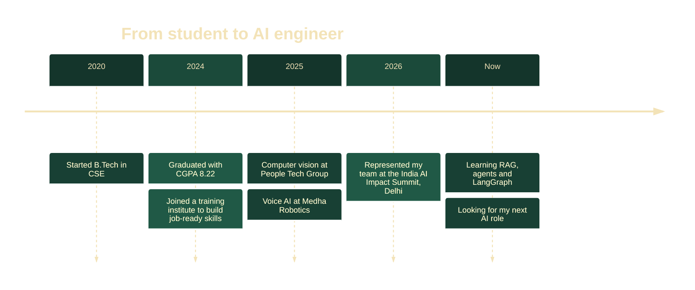
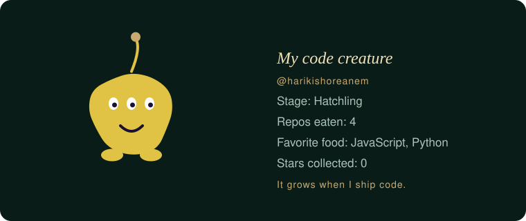

[LinkedIn](https://linkedin.com/in/harikishore-anem-27b62424a) · [Email](mailto:harikishoreanem@gmail.com) · [Resume](Harikishore_Anem_Resume.pdf) · Portfolio: coming soon · Hyderabad, open to relocation

I’m a developer who builds AI systems that work in real time. At People Tech Group I trained and tuned YOLO models that detect objects on live video, and at Medha Robotics I built a multilingual voice assistant that was showcased at the India AI Impact Summit 2026 in Delhi. I enjoy the hands-on side of AI: collecting and cleaning data, training models, and getting them to run on real cameras and microphones. I’m looking for AI Engineer and Machine Learning Engineer roles and I’m open to relocating.

A multilingual voice assistant that I worked on at Medha Robotics, showcased at the India AI Impact Summit 2026 in Delhi. The code is private, so I walk through the architecture and my part in interviews.

YOLOv7 and YOLOv8 models that tell helmet from no helmet, running on live ESP32-CAM video through OpenCV. I labelled the dataset in Roboflow, trained the models, and tuned the pipeline for real-time use. *Repo coming soon.*

| Area | Strong | Working knowledge |
|---|---|---|
| Programming and data | Python, SQL, NumPy, Pandas | – |
| ML and deep learning | PyTorch, TensorFlow, CNNs | – |
| Computer vision | OpenCV, YOLO, object detection | – |
| Speech | Speech to text, text to speech | – |
| Generative AI | – | LLM APIs, RAG, vector databases, agents, LangGraph, MCP |
| Engineering | Git and GitHub | REST APIs, CI/CD, AWS |

**Junior Software Developer, Medha Robotics** · Nov 2025 to Sep 2026 · Hyderabad
Worked on a multilingual AI voice assistant and represented the team at the India AI Impact Summit 2026 in Delhi. Explored robotics simulation with NVIDIA Isaac Sim and tested workflows with the GR00T N1.5 model.

**Junior Software Developer, People Tech Group** · May 2025 to Oct 2025 · Hyderabad
Trained and tuned YOLO models for a bike safety system designed to stop the bike from starting when the rider is not wearing a helmet. My part was the model: collecting and annotating data, preprocessing, training and evaluation, using Python, OpenCV, NumPy and Pandas.

**B.Tech in Computer Science and Engineering**, Avanthi Institute of Engineering and Technology, Makavarapalem · 2020 to 2024 · CGPA 8.22

<b>Quick facts for recruiters</b>

| | |
|---|---|
| **Roles I want** | AI Engineer, Machine Learning Engineer |
| **Currently learning** | RAG, agentic AI, LangGraph |
| **Also explored** | NVIDIA Isaac Sim and the GR00T N1.5 model for robotics simulation |
| **Location** | Hyderabad, open to relocation |

This creature is generated automatically every day from my public repositories. It grows when I ship code.

