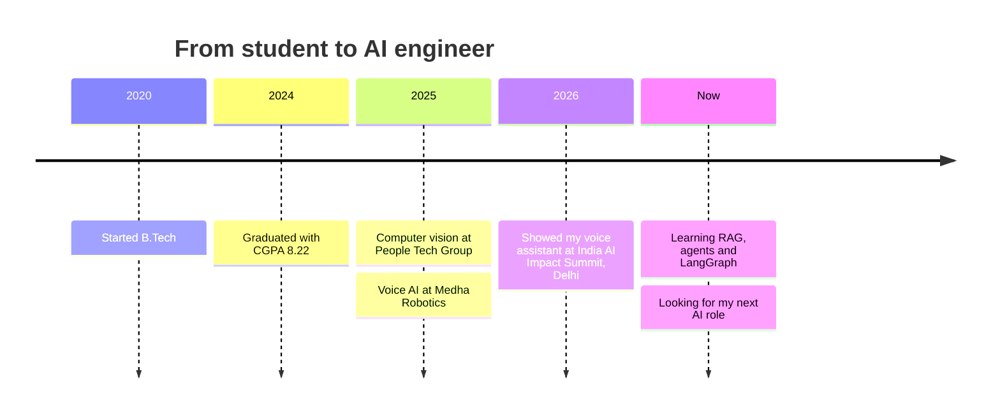

[LinkedIn](https://linkedin.com/in/harikishore-anem-27b62424a) · [Email](mailto:harikishoreanem@gmail.com) · Portfolio: coming soon · Hyderabad, open to relocation

I build AI that **sees** and **listens**. At People Tech Group I trained real-time computer vision models. At Medha Robotics I built a multilingual voice assistant and showed it at the **India AI Impact Summit 2026** in Delhi. I like the moment a model leaves the notebook and starts working on a live camera or a live microphone.

Right now I’m looking for my next AI / ML role.

## What I build

Wake-word detection, speech to text, an LLM (TinyLLaMA) and Sarvam AI for multilingual replies, then text to speech. I built the full end-to-end pipeline and showed it at the India AI Impact Summit 2026. *Repo coming soon.*

YOLO models that spot helmets and distracted drivers, running on live ESP32-CAM video through OpenCV. I collected and annotated the data, trained the models, and tuned the pipeline for real-time use. *Repo coming soon.*

## How I work

| 👁️ I make machines see | 🎧 I make machines listen | 🛠️ I make it all run |
|---|---|---|
| YOLO · OpenCV · object detection · image classification · real-time inference | STT · TTS · LLM APIs · multilingual voice · RAG, agents, LangGraph (learning) | Python · PyTorch · TensorFlow · SQL · Pandas · Git · REST APIs · AWS (basic) |

## My path so far

<b>Quick facts for recruiters</b>

| | |
|---|---|
| **Role I want** | AI / ML engineer: computer vision, voice AI, LLM applications |
| **Education** | B.Tech, Avanthi Institute of Engineering and Technology, CGPA 8.22 |
| **Experience** | Junior Software Developer, Medha Robotics (11/2025 to 09/2026) · Junior Software Developer, People Tech Group (05/2025 to 10/2025) |
| **Also explored** | NVIDIA Isaac Sim and the GR00T N1.5 model for robotics simulation |
| **Still learning** | RAG, agentic AI, LangGraph, vector databases, MCP |
| **Limitations** | Cannot walk past a noisy dataset without cleaning it |

## This profile grows

This creature is generated automatically every day from my public repositories. It grows when I ship code.

